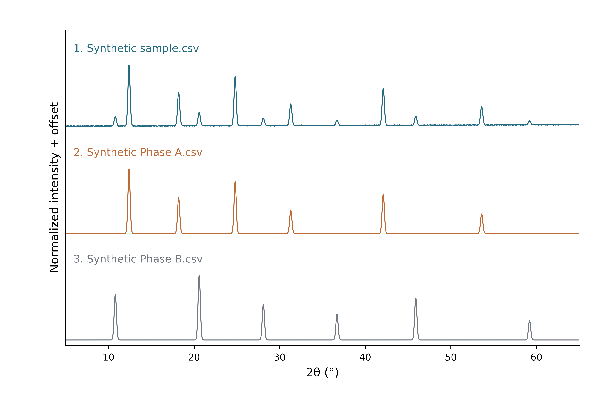

# XRD Workbench

本地运行的粉末 XRD 数据处理工具。导入数值谱线，与参考谱比较，生成图谱和分析报告。

[English](README.en.md) · [使用教程](docs/TUTORIAL.zh-CN.md) · [分析方法](docs/METHODS.md) · [导出与复现](docs/REPRODUCIBILITY.md)



图中为合成示例，不对应真实化合物。

## 功能

- 读取 TXT、CSV、XY、DAT、TSV 连续谱，支持列选择和仪器文件头。
- 裁剪角度范围、归一化，可选 AsLS 背景扣除和 Savitzky–Golay 平滑。
- 寻峰、计算已知波长下的 d 间距，与参考谱进行逐峰比较。
- 分别绘制原始样品谱和参考对比图，导出 PDF、SVG、600 dpi PNG/TIFF。
- 记录参考化合物、化学式、结构和来源，生成主要峰与候选物相报告。
- 保存原始文件、处理数据、参数和复现脚本。

计算在本机完成。参考谱由用户提供，程序不附带物相数据库。

## 安装与启动

需要 Python 3.11–3.13。

```bash
git clone https://github.com/threek-1/xrd-workbench.git
cd xrd-workbench
python3 -m venv .venv
source .venv/bin/activate
python -m pip install -e .
xrd-workbench ui
```

`pip install -e .` 必须在含 `pyproject.toml` 的项目目录执行；不要跳过 `cd xrd-workbench`。若安装报错，先解决错误再运行启动命令。

浏览器打开 <http://127.0.0.1:8501>。Windows 安装步骤见[使用教程](docs/TUTORIAL.zh-CN.md#2-安装与启动)。首次安装需联网下载依赖；日常分析在本地运行。服务按本地单用户使用设计。

## 输入

文件应包含连续的 **2θ（度）** 和强度两列，例如：

```text
2theta,intensity
5.00,107
5.02,108
5.04,111
5.06,109
5.08,112
```

支持逗号、Tab、空白和分号分隔，以及 UTF-8、GB18030 编码。多列文件需手动指定角度与强度列。重复角度、缺失值和非有限数会报错；含数值型文件头时需指定跳过行数。

每个文件最多 20 MB、200,000 点。波长未知时可留空，此时不计算 d 间距。暂不支持 CIF、专有 RAW、XRDML、图片或离散棒图输入。

## 使用

1. 关闭侧栏的“使用合成示例”，上传样品和参考谱。
2. 填写已知的参考物相与来源；未知项留空。
3. 设置处理参数，点击“运行分析并生成图谱”。
4. 查看实测谱图、对比图、分析报告和逐峰证据。
5. 下载图谱或完整分析包。

实测单图保留全部导入点与原始强度。对比图和报告使用所选处理参数。修改参数后需重新运行。

匹配分数用于参考库内排序，不代表鉴定概率或物相含量。报告中的名称来自用户填写的信息；程序不执行晶体结构求解、Rietveld 精修或定量物相分析。具体算法与限制见[分析方法](docs/METHODS.md)。

## 命令行

```bash
xrd-workbench analyze "examples/Synthetic sample.csv" \
  --reference "examples/Synthetic Phase A.csv" \
  --reference "examples/Synthetic Phase B.csv" \
  --wavelength 1.5406 \
  --output runs/demo.zip
```

默认不扣背景、不平滑、不优化平移。更多选项运行 `xrd-workbench analyze --help`。

## 开发

```bash
python -m pip install -e ".[dev]"
python -m pytest -q
python -m build
```

提交问题或修改前请阅读[贡献指南](CONTRIBUTING.md)。

## 许可证

采用 [AGPL-3.0-or-later](LICENSE)。仓库包含源码、教程和合成示例；上传数据保留原来源的权利。示例生成方式见[数据说明](docs/DATA.md)。
